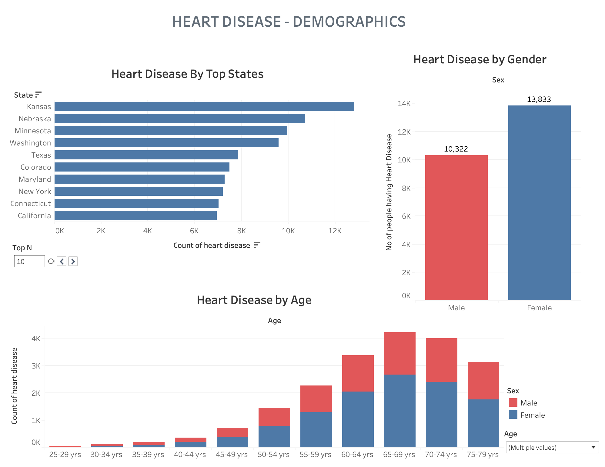
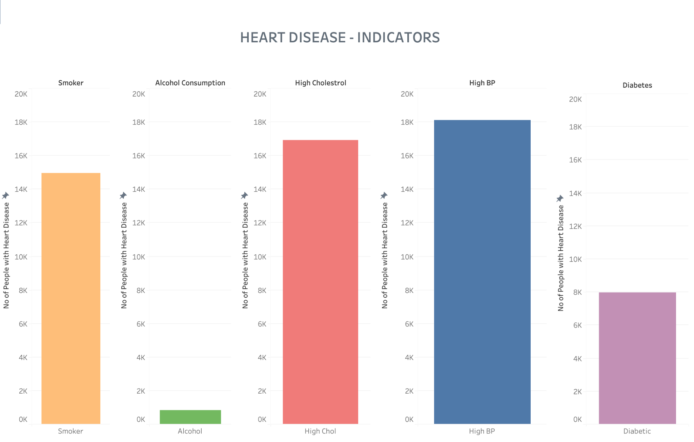

# Heart Disease Risk Indicators

**Finding the strongest predictors of heart disease in 250,000+ CDC survey responses, and turning them into a prevention incentive plan for health insurers.**




## Overview

Heart disease causes about one in three deaths in the United States, and insurers spend an average of roughly $73,000 per heart disease patient. This project uses the CDC's 2015 Behavioral Risk Factor Surveillance System (BRFSS) survey to:

1. identify which health and lifestyle factors are most associated with heart disease,
2. profile high-risk applicants in interactive Tableau dashboards, and
3. design an incentive program, grounded in behavioral economics, that insurers can use to lower that risk.

## Key findings

- **Top indicators:** high blood pressure, high cholesterol, smoking and diabetes. Mental health also stood out: 34% of respondents with a mental health condition also reported heart disease.
- **Age and sex:** risk rises sharply after 45 and peaks at 65–69. In this dataset more women (13,833) than men (10,322) reported heart disease, with the gap widest between ages 55 and 74.
- **Geography:** Kansas, Nebraska, Minnesota, Washington and Texas had the highest case counts.
- **Segments:** k-means clustering produced three groups. The highest-risk group was older (60–65), lower-income, less physically active, and had higher rates of smoking and diabetes.
- **Model:** logistic regression reached **90.6% accuracy** and **53.8% precision**. Only about 10% of respondents had heart disease, so recall was low (≈12%). The model is better at ranking risk than at flagging every case, which is why the recommendations focus on prevention across the high-risk profile.



## Recommendation: "Invest in Your Health, Reap the Rewards"

Cutting a member's heart disease risk by just 5% saves an insurer about **$3,650 per person**. The proposed program uses immediate, tangible rewards to counter present bias:

| Step | What the member does | Reward |
| --- | --- | --- |
| Sign up | Complete a free health screening | $50 |
| Set goals | Pick up to two monthly goals: 8,000 steps a day, no added sugar, lose 5 lbs, a smoke-free month, or a stress-management group | — |
| 1 month | Complete a one-month challenge | $100 |
| 2 months | Complete a two-month challenge | Smartwatch |
| 3 months | Complete a three-month challenge | $300 + lower premium |

Members who leave the program early forfeit the $50 sign-up bonus.

## Approach

1. **Cleaning:** reduced the BRFSS file from 330 columns to 20 evidence-based risk factors (blood pressure, cholesterol, BMI, smoking, diabetes, activity, diet, alcohol, healthcare access, general, mental and physical health, age, sex, income, state). Recoded survey answers to binary or ordinal values and dropped "don't know" and "refused" responses.
2. **Modeling:** trained logistic regression, decision tree and random forest classifiers with a 70/30 train/test split.
3. **Visualization:** built Tableau dashboards covering demographics, indicators, applicant profiling and state vs. national risk.

## Repository structure

```
├── assets/                          README images
├── dashboards/
│   └── heart_disease_dashboard.twb  Tableau workbook
├── data/                            put the BRFSS CSV here (not committed)
├── reports/
│   ├── heart_disease_report.pdf     full write-up
│   └── heart_disease_presentation.pptx
├── src/
│   └── heart_disease_analysis.py    cleaning, modeling and Tableau prep
└── requirements.txt
```

## Getting started

```bash
git clone https://github.com/dhoniobond/heart-risk-indicators.git
cd heart-risk-indicators
python -m venv .venv
source .venv/bin/activate        # Windows: .venv\Scripts\activate
pip install -r requirements.txt
```

1. Download the 2015 BRFSS file as `data/2015.csv` (see [data/README.md](data/README.md)).
2. Run `python src/heart_disease_analysis.py`. The cleaned and state-level CSVs it writes go to `data/`.
3. Open `dashboards/heart_disease_dashboard.twb` in Tableau. If it asks for the data source, point it to the CSVs in `data/`.

## Limitations

- Cleaning reduced the raw survey substantially, and the classes are imbalanced (about 10% positive).
- The data is from 2015, so prevalence may have shifted since then. The risk factors themselves are well established.
- Financial incentives won't motivate every member.

## Team

Dhanush Srinath · Dharmaja Patel · Akhil Khajuria

*MISM 6210 — Information Visuals and Dashboards for Business, Northeastern University (Spring 2023)*
